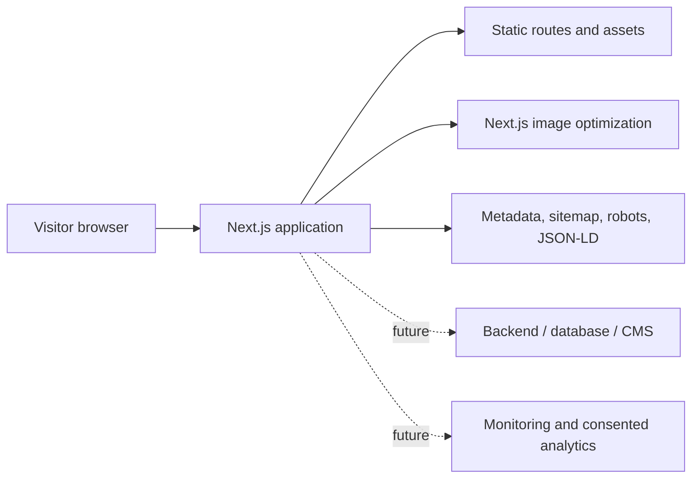
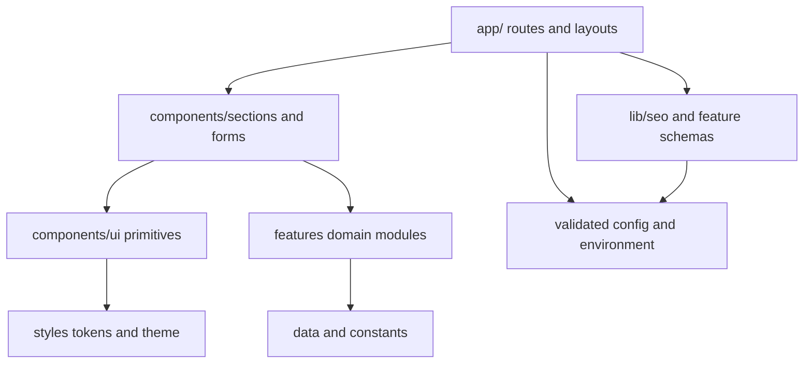
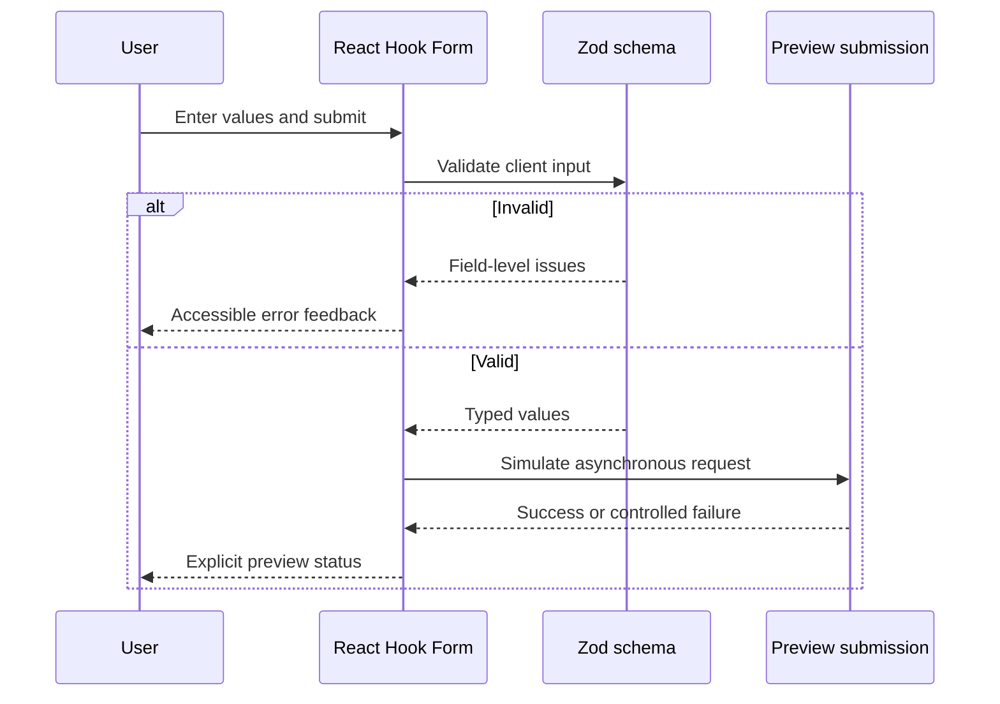
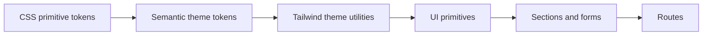
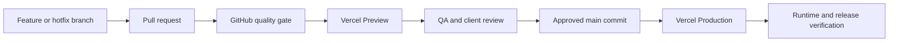

# Architecture

QUBO uses a layered Next.js App Router architecture. Routes compose reusable sections,
features own domain behavior, and all presentation is constrained by the shared design-token system.

## System context



Version 0.1 has no backend, database, authentication, CMS, analytics, or monitoring connection. Form
submission behavior is an explicit client-side preview and no personal data is sent or stored.

## Layer model



Dependency direction should move downward. Generic UI must not import route or business-specific
modules.

## Request and render flow

1. Next.js resolves a route in `app/`.
2. The root layout applies global metadata, site structured data, Navbar, and Footer.
3. The route renders one `PageWrapper`, route JSON-LD, and the required sections.
4. Server Components generate static HTML wherever possible.
5. Client Components hydrate only interactive islands such as animation, forms, navigation, carousel,
   lightbox, and disclosure controls.
6. Tailwind utilities resolve to the approved CSS tokens.
7. Environment-aware metadata selects the correct canonical origin and indexing policy.

## Root layout and page composition

`app/layout.tsx` owns elements shared by every route:

- document language;
- root metadata;
- WebSite and LocalBusiness JSON-LD;
- Navbar;
- page content slot;
- Footer.

Each route owns its main content and must render one main element through `PageWrapper`. This avoids
duplicating global navigation and maintains a stable skip-link target.

The homepage composition is intentionally linear:

```text
Hero
Services
How It Works
Why Choose Us
Statistics
Testimonials
Gallery
FAQ
Estimate
Contact
Final CTA
```

This order moves the user from understanding to trust, proof, questions, and conversion.

## Route generation

Static routes are ordinary App Router page modules. Repeated content uses dynamic static templates:

- `/services/[slug]` reads `data/services.ts` and uses `generateStaticParams`;
- `/zone-servite/[slug]` reads `data/serviceAreas.ts` and uses `generateStaticParams`.

Unknown slugs call `notFound()` and use the branded, non-indexable 404 page. This architecture adds
new services or cities through validated records rather than duplicated page templates.

## Server and client boundaries

Prefer Server Components for:

- layouts and pages;
- static content composition;
- metadata generation;
- structured-data generation;
- route parameter resolution.

Client Components are justified for:

- Framer Motion and reduced-motion decisions;
- browser event handling;
- local interaction state;
- React Hook Form;
- file preview URLs;
- focus trapping and dismissible overlays;
- viewport or scroll observation.

Keep client boundaries low in the tree so static page content does not require unnecessary
JavaScript.

## Domain features

### Services

`features/services/` provides service lookup, related-service selection, types, and Service schema.
The UI receives typed service records and does not repeat lookup rules.

### Service areas

`features/serviceAreas/` provides area lookup, related-area selection, types, and local structured
data. City pages remain unique records rendered through one template.

### Estimate and contact



When a backend is introduced, the preview function will be replaced behind the feature boundary.
Server-side validation, abuse protection, privacy, retention, and operational error reporting must be
added before real data collection.

### Uploads

`features/upload/` validates image file type and size. `UploadField` owns drag-and-drop, previews,
removal, and accessible feedback. Files currently remain only in browser memory.

## Design system architecture



`styles/tokens.css` is the primitive and semantic source. `styles/theme.css` maps the approved system
into Tailwind utilities. Components consume semantic utilities instead of raw color, spacing,
radius, shadow, or motion values.

The responsive grid uses 4 columns on mobile, 8 on tablet, and 12 on desktop. Containers, gutters,
touch targets, typography, radii, shadows, timing, z-index, and opacity are tokenized.

## Motion architecture

Framer Motion transitions and sequences live in `constants/motion.ts`. Components use shared reveal,
hero, modal, drawer, and interaction behavior. CSS token overrides reduce durations and transforms
under `prefers-reduced-motion`.

Motion never carries essential information. Static content and control semantics remain available
without animation.

## SEO architecture

SEO is divided into shared and domain-specific layers:

- `config/site.ts` — identity, locale, region, canonical origin, indexability;
- `lib/seo/metadata.ts` — page, root, Open Graph, and Twitter metadata;
- `lib/seo/structuredData.ts` — WebSite, LocalBusiness, WebPage, and breadcrumbs;
- feature schema generators — Service and local-area structured data;
- `app/sitemap.ts` — static, service, and area URLs;
- `app/robots.ts` — environment-aware crawler policy;
- `components/seo/SocialImage.tsx` — shared generated social image design.

JSON-LD is serialized with `<` escaped before insertion. Production canonical URLs are impossible to
enable without a valid explicit HTTPS origin.

## Environment architecture

`config/env.ts` parses environment values with Zod and returns:

- resolved site origin;
- deployment target;
- indexing state.

Rules:

- local development falls back to `http://localhost:3000`;
- Preview can use `VERCEL_URL` and remains non-indexable;
- Vercel Production requires `NEXT_PUBLIC_SITE_URL`;
- the production origin must use HTTPS and contain no path or credentials.

`config/site.ts` consumes this validated result. Other modules do not read deployment variables
directly.

## Security architecture

Current defenses include:

- strict TypeScript and schema validation;
- safe React output encoding;
- escaped JSON-LD serialization;
- no rendering of user-provided HTML;
- upload type, size, and count validation;
- CSP and frame restrictions;
- MIME sniffing protection;
- Referrer and Permissions policies;
- HSTS for HTTPS clients;
- no committed secrets;
- no production browser source maps;
- environment-aware crawler restrictions;
- production dependency audit in QA.

Future server endpoints must add server validation, rate limiting, safe storage, structured logging,
and provider-specific authorization. Client validation alone is not a security boundary.

## Testing architecture

Tests are primarily colocated with source. The current suite covers:

- UI primitive behavior and accessibility;
- navigation, footer, sections, forms, gallery, FAQ, and hero;
- Zod schemas and upload validation;
- service and area lookup;
- metadata, structured data, sitemap, robots, security headers, and environment resolution;
- route composition and heading structure.

`tests/setup.ts` configures the shared jsdom test environment. `npm run check` is the local, CI, and
Vercel quality gate.

Approved future layers include Playwright critical journeys, screenshot regression, and Lighthouse
CI. They should be introduced without replacing the fast unit and component foundation.

## Deployment architecture



Both GitHub CI and Vercel run the same `npm run check` command after `npm ci`. Vercel deployment
history provides the primary rollback mechanism.

## Extension points

The current boundaries support future additions without moving existing presentation code:

- real form delivery through feature actions and `services/` clients;
- Supabase or PostgreSQL through `lib/`, `services/`, and `actions/`;
- CMS content replacing records in `data/`;
- localization through `locales/` and middleware;
- authentication and protected areas through middleware and providers;
- booking, accounts, payments, notifications, CRM, and admin features under `features/` and `app/`;
- monitoring and consented analytics through dedicated configuration and providers.

Every integration must be approved, typed, tested, privacy-reviewed, and added without weakening the
existing dependency direction.
